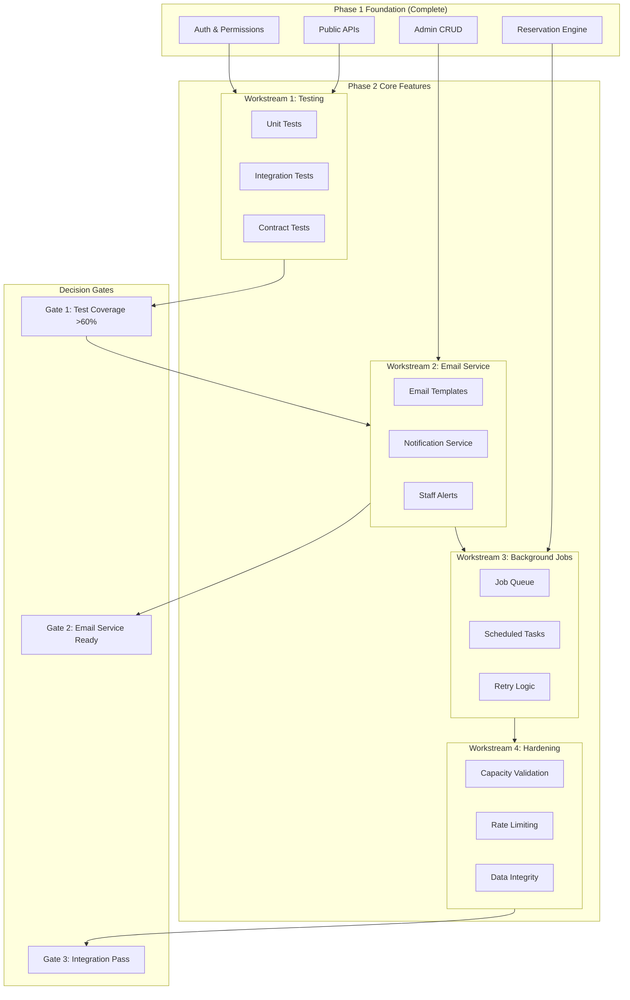

# Phase 2: Core Features & Integration - Strategic Plan

## Executive Summary

This strategic plan defines Phase 2 of the restaurant management platform, building directly upon the foundational infrastructure established in Phase 1. Phase 2 focuses on completing the core business functionality: email notifications, comprehensive testing, background job processing, and system hardening to deliver a production-ready MVP.

---

## Phase 1 Foundation Assessment

### Achieved Milestones (Completed)

| Milestone | Status | Artifacts | Validation Method |
|-----------|--------|-----------|-------------------|
| URL Routing Structure | Complete | [`backend/config/urls.py`](backend/config/urls.py:1) | All endpoints accessible at `/api/v1/` |
| Permission Classes | Complete | [`backend/core/permissions.py`](backend/core/permissions.py:1) | Role-based access matrix implemented |
| Authentication Endpoints | Complete | [`backend/accounts/views.py`](backend/accounts/views.py:1) | JWT login/refresh/logout/me functional |
| Error Standardization | Complete | [`backend/core/exceptions.py`](backend/core/exceptions.py:1) | Consistent error schema across API |
| Health Check | Complete | [`backend/core/views.py`](backend/core/views.py:1) | `/health/` endpoint returns 200 |
| Request Logging | Complete | [`backend/core/middleware.py`](backend/core/middleware.py:1) | Structured logs with request IDs |
| Public Restaurant APIs | Complete | [`backend/restaurant/views_public.py`](backend/restaurant/views_public.py:1) | Info, hours, gallery, testimonials, blog |
| Public Menu APIs | Complete | [`backend/menu/views_public.py`](backend/menu/views_public.py:1) | Full menu with categories/items/variants |
| Public Reservation APIs | Complete | [`backend/reservations/views_public.py`](backend/reservations/views_public.py:1) | Availability, create, modify, cancel |
| Admin Content CRUD | Complete | [`backend/restaurant/views_admin.py`](backend/restaurant/views_admin.py:1), [`backend/menu/views_admin.py`](backend/menu/views_admin.py:1) | Full CRUD with audit logging |
| Admin Reservation Management | Complete | [`backend/reservations/views_admin.py`](backend/reservations/views_admin.py:1) | List, filter, approve, cancel |
| Reservation Policy Engine | Complete | [`backend/reservations/models.py`](backend/reservations/models.py:1) | Approval triggers, capacity checks |

### Phase 1 Gaps Identified

| Gap | Impact | Phase 2 Resolution |
|-----|--------|-------------------|
| No test coverage | High risk of regression | Workstream 1: Comprehensive Testing |
| No email notifications | Missing guest/staff communication | Workstream 2: Email Service |
| No background jobs | Synchronous processing bottlenecks | Workstream 3: Job Processing |
| Missing capacity validation on modify | Overbooking risk | Workstream 4: System Hardening |
| No integration tests | Component isolation unknown | Workstream 5: Integration Testing |

---

## Phase 2 Strategic Objectives

### Primary Objectives

1. **Establish Quality Assurance Foundation**
   - Achieve >80% code coverage across all modules
   - Implement contract testing for API stability
   - Create automated regression test suite

2. **Enable Guest Communication**
   - Implement transactional email service
   - Create email template system
   - Establish staff notification workflows

3. **Build Background Processing Infrastructure**
   - Implement job queue with retry logic
   - Create scheduled task framework
   - Enable async email delivery

4. **Harden System Reliability**
   - Add capacity validation on reservation modifications
   - Implement rate limiting on all public endpoints
   - Add data integrity constraints

5. **Validate System Integration**
   - End-to-end reservation flow testing
   - Cross-module integration validation
   - Performance baseline establishment

---

## Workstream Architecture



---

## Detailed Workstreams

### Workstream 1: Comprehensive Testing

**Objective**: Establish robust test coverage to prevent regression and enable confident iteration.

**Deliverables**:
- Unit tests for all permission classes
- Unit tests for authentication flows
- Unit tests for reservation policy engine
- Unit tests for capacity calculation logic
- Integration tests for public API endpoints
- Integration tests for admin API endpoints
- Contract tests validating API responses against [`docs/API/CONTRACT.md`](docs/API/CONTRACT.md:1)

**Dependencies on Phase 1**:
- [`backend/core/permissions.py`](backend/core/permissions.py:1) - Permission classes to test
- [`backend/accounts/views.py`](backend/accounts/views.py:1) - Auth endpoints to test
- [`backend/reservations/views_public.py`](backend/reservations/views_public.py:1) - Reservation flows to test

**Success Criteria**:
- [ ] 80%+ code coverage across all modules
- [ ] All auth flows have passing tests
- [ ] All reservation policy scenarios tested
- [ ] API contract validation passes

**Timeline**: Week 1-2

---

### Workstream 2: Email Notification Service

**Objective**: Implement transactional email system for guest and staff notifications.

**Deliverables**:
- Email service abstraction layer
- Template system for guest notifications
- SMTP and console backends
- Event-driven email triggers

**Email Templates Required**:

| Template | Recipient | Trigger | Priority |
|----------|-----------|---------|----------|
| `reservation_confirmed` | Guest | Reservation auto-confirmed | High |
| `reservation_pending` | Guest | Reservation requires approval | High |
| `reservation_modified` | Guest | Guest modifies reservation | High |
| `reservation_cancelled` | Guest | Guest cancels reservation | High |
| `staff_new_pending` | Staff | New pending reservation | High |
| `staff_reservation_cancelled` | Staff | Guest cancels | Medium |

**Dependencies on Phase 1**:
- [`backend/reservations/views_public.py`](backend/reservations/views_public.py:147) - Reservation creation
- [`backend/reservations/views_public.py`](backend/reservations/views_public.py:360) - Reservation modification
- [`backend/reservations/views_public.py`](backend/reservations/views_public.py:472) - Reservation cancellation
- [`backend/core/models.py`](backend/core/models.py:1) - AuditEvent for trigger hooks

**Success Criteria**:
- [ ] All 6 email templates implemented
- [ ] Console backend works in development
- [ ] SMTP backend configurable via environment
- [ ] Emails triggered on all reservation state changes
- [ ] Staff notifications sent to configured inbox

**Timeline**: Week 2-3

---

### Workstream 3: Background Job Processing

**Objective**: Implement asynchronous processing for email delivery and scheduled maintenance.

**Deliverables**:
- Job queue integration (Django-Q or Celery)
- Async email delivery tasks
- Scheduled cleanup jobs
- Token expiration cleanup
- Dead letter queue handling

**Jobs Required**:

| Job | Schedule | Description |
|-----|----------|-------------|
| `send_email_async` | On-demand | Async email delivery |
| `cleanup_expired_tokens` | Daily | Remove expired reservation tokens |
| `cleanup_old_audit_events` | Weekly | Archive old audit logs |
| `reservation_reminders` | Hourly | Send upcoming reservation reminders |

**Dependencies on Phase 1**:
- [`backend/reservations/models.py`](backend/reservations/models.py:150) - ReservationToken model
- [`backend/core/models.py`](backend/core/models.py:1) - AuditEvent model

**Success Criteria**:
- [ ] Job queue processes tasks without blocking requests
- [ ] Failed jobs retry with exponential backoff
- [ ] Scheduled jobs run on schedule
- [ ] Dead letter queue captures persistent failures

**Timeline**: Week 3-4

---

### Workstream 4: System Hardening

**Objective**: Add validation, rate limiting, and data integrity to prevent abuse and errors.

**Deliverables**:
- Capacity validation on reservation modification
- Rate limiting on all public endpoints
- Data integrity constraints
- Input sanitization

**Hardening Tasks**:

| Task | Location | Description |
|------|----------|-------------|
| Capacity check on modify | [`ReservationModifyView`](backend/reservations/views_public.py:360) | Validate new time/party size fits capacity |
| Rate limit reservation create | [`ReservationCreateView`](backend/reservations/views_public.py:147) | 10/min, 50/hour per IP |
| Rate limit availability | [`AvailabilityView`](backend/reservations/views_public.py:20) | 30/min per IP |
| Alt-text validation | Gallery admin | Enforce non-empty alt text |

**Dependencies on Phase 1**:
- [`backend/reservations/views_public.py`](backend/reservations/views_public.py:120) - Capacity check logic
- [`backend/core/middleware.py`](backend/core/middleware.py:1) - Request logging for rate limiting

**Success Criteria**:
- [ ] Modification re-validates capacity
- [ ] Rate limits enforced on all public endpoints
- [ ] Alt-text validation prevents publish without alt
- [ ] No overbooking possible through API

**Timeline**: Week 4

---

### Workstream 5: Integration Testing & Validation

**Objective**: Validate that all Phase 1 and Phase 2 components function as a unified system.

**Deliverables**:
- End-to-end reservation flow tests
- Cross-module integration tests
- Performance baseline tests
- Load testing for reservation endpoints

**Integration Scenarios**:

| Scenario | Flow | Validation |
|----------|------|------------|
| Full booking flow | Availability → Create → Email → Modify → Cancel | All steps succeed, emails sent |
| Admin approval flow | Guest creates pending → Staff approves → Guest notified | Status transitions correct |
| Capacity enforcement | Fill slot → Try overbook → Rejection | Capacity respected |
| Auth flow | Login → Access admin → Refresh → Logout | Tokens work correctly |

**Dependencies on Phase 1 & 2**:
- All Phase 1 endpoints
- All Phase 2 email service
- All Phase 2 background jobs

**Success Criteria**:
- [ ] All integration scenarios pass
- [ ] API response times < 200ms (p95)
- [ ] Reservation creation handles 100 concurrent requests
- [ ] No data inconsistencies across modules

**Timeline**: Week 4-5

---

## Decision Gates

### Gate 1: Test Coverage Threshold
**Location**: End of Workstream 1
**Criteria**:
- [ ] Overall code coverage >= 60%
- [ ] All permission classes tested
- [ ] All auth endpoints tested
- [ ] Critical reservation logic tested

**Exit Actions**:
- If PASS: Proceed to Workstream 2
- If FAIL: Extend Workstream 1, identify untested code paths

### Gate 2: Email Service Validation
**Location**: End of Workstream 2
**Criteria**:
- [ ] All email templates render correctly
- [ ] Console backend captures all emails
- [ ] No blocking calls in request handlers
- [ ] Staff notification configuration works

**Exit Actions**:
- If PASS: Proceed to Workstream 3
- If FAIL: Fix email rendering/blocking issues

### Gate 3: Integration Readiness
**Location**: End of Workstream 5
**Criteria**:
- [ ] All integration scenarios pass
- [ ] Performance benchmarks met
- [ ] No critical bugs open
- [ ] Documentation complete

**Exit Actions**:
- If PASS: Phase 2 complete, proceed to Phase 3 planning
- If FAIL: Address integration issues, re-test

---

## Phase 1 Artifact Validation Requirements

Before Phase 2 execution begins, the following Phase 1 artifacts must be validated:

### Required Validations

| Artifact | Validation Method | Owner | Due Date |
|----------|-------------------|-------|----------|
| [`backend/core/permissions.py`](backend/core/permissions.py:1) | Manual role matrix test | QA | Day 1 |
| [`backend/accounts/views.py`](backend/accounts/views.py:1) | Auth flow smoke test | Dev | Day 1 |
| [`backend/config/urls.py`](backend/config/urls.py:1) | Endpoint accessibility check | Dev | Day 1 |
| [`backend/core/exceptions.py`](backend/core/exceptions.py:1) | Error response format check | Dev | Day 1 |
| [`backend/reservations/views_public.py`](backend/reservations/views_public.py:1) | Reservation flow smoke test | QA | Day 2 |
| [`backend/reservations/models.py`](backend/reservations/models.py:1) | Policy configuration check | Dev | Day 2 |

### Validation Checklist

- [ ] All URLs resolve correctly
- [ ] Authentication returns valid JWT
- [ ] Permissions block unauthorized access
- [ ] Error responses follow contract schema
- [ ] Reservation creation works end-to-end
- [ ] Admin CRUD operations functional
- [ ] Health check endpoint returns 200

---

## Resource Requirements

### Personnel

| Role | Allocation | Responsibilities |
|------|------------|------------------|
| Backend Developer | 100% | Workstreams 1-4 implementation |
| QA Engineer | 50% | Test design, integration testing |
| DevOps Engineer | 25% | Job queue setup, monitoring |
| Tech Lead | 25% | Architecture review, gate decisions |

### Infrastructure

| Resource | Purpose | Estimated Cost |
|----------|---------|----------------|
| Redis instance | Job queue backend | $20/month |
| SMTP service | Email delivery (SendGrid/Mailgun) | $0-20/month |
| Test environment | Isolated testing | $50/month |

### Tools & Libraries

| Tool | Purpose | Integration Point |
|------|---------|-------------------|
| Django-Q or Celery | Job queue | [`backend/config/settings.py`](backend/config/settings.py:1) |
| factory_boy | Test fixtures | Test suite |
| pytest-django | Test framework | Test suite |
| responses | HTTP mocking | Email tests |
| freezegun | Time manipulation | Reservation tests |

---

## Risk Mitigation Strategies

### Risk Register

| Risk | Likelihood | Impact | Mitigation Strategy |
|------|------------|--------|---------------------|
| Test coverage takes longer than planned | Medium | High | Prioritize critical paths first; accept 70% if 80% unreachable |
| Email service integration complexity | Medium | Medium | Start with console backend; add SMTP later |
| Job queue adds deployment complexity | Medium | Medium | Use Django-Q for simpler setup; document Docker changes |
| Capacity validation bugs | Low | High | Extensive unit testing; property-based testing for edge cases |
| Integration test flakiness | Medium | Medium | Use test database; freeze time; mock external services |

### Contingency Plans

**If Workstream 1 overruns by >3 days**:
- Reduce integration test scope
- Focus on critical path coverage only
- Defer edge case testing to Phase 3

**If email service blocked**:
- Implement console-only backend
- Document SMTP configuration for later
- Proceed with other workstreams

**If job queue setup fails**:
- Use synchronous email as fallback
- Document async as known limitation
- Prioritize for Phase 3

---

## Timeline & Dependencies

### Phase 2 Timeline (5 Weeks)

```
Week 1: [Workstream 1] Testing Foundation
  Day 1-2: Phase 1 validation, test infrastructure
  Day 3-5: Unit tests for permissions, auth, reservations
  Gate 1: Test coverage >= 60%

Week 2: [Workstream 1 cont + Workstream 2 start] Testing + Email
  Day 1-3: Integration tests, contract tests
  Day 4-5: Email service setup, template system

Week 3: [Workstream 2 cont + Workstream 3] Email + Jobs
  Day 1-3: Email templates, notification triggers
  Day 4-5: Job queue setup, async email tasks
  Gate 2: Email service validation

Week 4: [Workstream 3 cont + Workstream 4] Jobs + Hardening
  Day 1-2: Scheduled jobs, cleanup tasks
  Day 3-4: Capacity validation, rate limiting
  Day 5: Data integrity constraints

Week 5: [Workstream 5] Integration & Validation
  Day 1-3: Integration test implementation
  Day 4: Performance testing, load testing
  Day 5: Documentation, gate review
  Gate 3: Integration readiness
```

### Critical Path

1. Phase 1 validation (Day 1)
2. Test infrastructure setup (Day 1-2)
3. Core unit tests (Day 3-5)
4. **Gate 1** (End Week 1)
5. Email service implementation (Week 2-3)
6. **Gate 2** (End Week 3)
7. Background jobs (Week 3-4)
8. System hardening (Week 4)
9. Integration testing (Week 5)
10. **Gate 3** (End Week 5)

---

## Stakeholder Communication Plan

### Communication Schedule

| Checkpoint | Audience | Format | Content |
|------------|----------|--------|---------|
| Phase 2 Kickoff | All | Meeting | Plan review, role assignments |
| End of Week 1 | Tech Lead | Written | Test coverage report, Gate 1 results |
| End of Week 2 | All | Demo | Test suite demo, email templates preview |
| End of Week 3 | Tech Lead | Written | Email service status, Gate 2 results |
| End of Week 4 | All | Demo | Background jobs, rate limiting demo |
| Phase 2 Review | All | Meeting | Full system demo, Phase 3 planning |

### Reporting Metrics

**Weekly Dashboard**:
- Test coverage percentage
- Open bugs by severity
- Completed workstreams
- Upcoming decision gates

**Gate Review Format**:
- Gate criteria checklist
- Pass/fail status for each criterion
- Required actions for failure
- Sign-off from Tech Lead

---

## Integration Testing Protocols

### Protocol 1: API Contract Validation

**Purpose**: Ensure all API responses match [`docs/API/CONTRACT.md`](docs/API/CONTRACT.md:1)

**Method**:
1. Generate API schema from code
2. Compare against contract document
3. Flag discrepancies
4. Update code or contract to match

**Tools**: DRF Spectacular, schemathesis

### Protocol 2: End-to-End Flow Testing

**Purpose**: Validate complete user journeys

**Flows to Test**:
1. Guest booking flow
2. Admin approval flow
3. Guest modification flow
4. Guest cancellation flow
5. Staff reservation management flow

**Method**:
1. Use test database with seeded data
2. Execute HTTP requests through full stack
3. Verify database state changes
4. Verify email delivery (captured)

### Protocol 3: Cross-Module Integration

**Purpose**: Ensure modules work together correctly

**Integration Points**:
- Auth → All admin endpoints
- Reservations → Email service
- Content → Audit logging
- Public APIs → Permission checks

**Method**:
1. Test each integration point
2. Verify data consistency
3. Test error propagation
4. Verify logging across modules

### Protocol 4: Performance Baseline

**Purpose**: Establish performance benchmarks

**Metrics**:
- API response time (p50, p95, p99)
- Database query count per endpoint
- Concurrent request handling
- Memory usage under load

**Method**:
1. Use locust or k6 for load testing
2. Measure baseline with 1, 10, 100 concurrent users
3. Identify bottlenecks
4. Document acceptable thresholds

---

## Success Criteria Summary

### Phase 2 Completion Criteria

| Category | Criteria | Measurement |
|----------|----------|-------------|
| Quality | Code coverage >= 80% | Coverage report |
| Functionality | All email templates working | Manual verification |
| Reliability | Background jobs processing | Job queue metrics |
| Security | Rate limiting enforced | Penetration test |
| Integration | All scenarios pass | Integration test results |
| Performance | p95 response < 200ms | Load test results |

### Definition of Done

- [ ] All workstreams complete
- [ ] All decision gates passed
- [ ] All success criteria met
- [ ] Documentation updated
- [ ] Stakeholder sign-off obtained

---

## Appendix A: Phase 1 → Phase 2 Dependency Map

```
Phase 1 Artifacts:
├── backend/core/permissions.py
│   └── Used by: Workstream 1 (tests), Workstream 4 (hardening)
├── backend/accounts/views.py
│   └── Used by: Workstream 1 (tests), Workstream 5 (integration)
├── backend/core/exceptions.py
│   └── Used by: All workstreams (error handling)
├── backend/reservations/views_public.py
│   └── Used by: Workstream 1 (tests), Workstream 2 (email triggers), Workstream 4 (hardening)
├── backend/reservations/models.py
│   └── Used by: Workstream 2 (email data), Workstream 3 (cleanup jobs)
├── backend/core/middleware.py
│   └── Used by: Workstream 4 (rate limiting data)
└── backend/config/urls.py
    └── Used by: Workstream 5 (integration tests)
```

---

## Appendix B: Email Template Specifications

### reservation_confirmed

**To**: Guest email
**Subject**: Your reservation at {{ restaurant_name }} is confirmed
**Context**:
- Guest name
- Party size
- Date/time
- Restaurant name
- Manage link

### reservation_pending

**To**: Guest email
**Subject**: Your reservation request at {{ restaurant_name }}
**Context**:
- Guest name
- Party size
- Date/time
- Restaurant name
- Note about approval

### reservation_modified

**To**: Guest email
**Subject**: Your reservation has been updated
**Context**:
- Guest name
- Updated details
- Previous details (optional)
- Manage link

### reservation_cancelled

**To**: Guest email
**Subject**: Your reservation has been cancelled
**Context**:
- Guest name
- Cancelled reservation details
- Rebooking CTA

### staff_new_pending

**To**: Staff inbox
**Subject**: New pending reservation requires approval
**Context**:
- Guest details
- Reservation details
- Admin approval link

### staff_reservation_cancelled

**To**: Staff inbox
**Subject**: Guest cancelled reservation
**Context**:
- Guest details
- Cancelled reservation details
- Reason (if provided)

---

## Appendix C: Background Job Specifications

### send_email_async

**Queue**: emails
**Priority**: Normal
**Retry**: 3 attempts with exponential backoff
**Timeout**: 30 seconds
**Arguments**:
- template_name (str)
- recipient (str)
- context (dict)

### cleanup_expired_tokens

**Schedule**: Daily at 3:00 AM
**Queue**: maintenance
**Priority**: Low
**Action**: Delete ReservationToken where expires_at < now()

### cleanup_old_audit_events

**Schedule**: Weekly on Sunday at 4:00 AM
**Queue**: maintenance
**Priority**: Low
**Action**: Archive audit events older than 90 days

### reservation_reminders

**Schedule**: Hourly
**Queue**: notifications
**Priority**: Normal
**Action**: Send reminder emails for reservations in next 24 hours

---

*Plan Version: 1.0*
*Last Updated: 2026-01-30*
*Next Review: End of Week 1*
