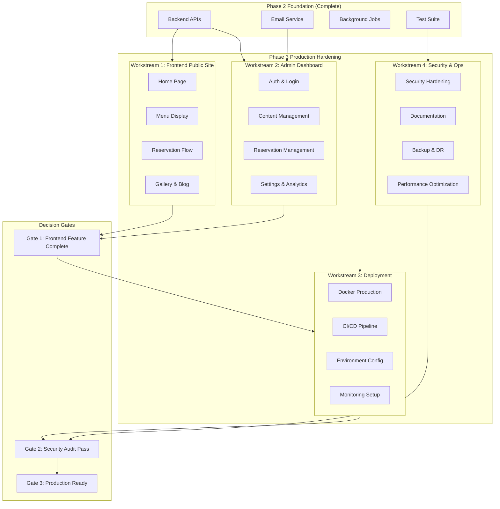

# Phase 3: Production Hardening & Scale-Out - Strategic Plan

## Executive Summary

This strategic plan defines Phase 3 of the restaurant management platform, building upon the production-ready MVP delivered by Phase 2. Phase 3 focuses on frontend implementation, deployment infrastructure, security hardening, and operational readiness to deliver a complete, deployable solution.

---

## Phase 2 Post-Execution Analysis

### Critical Success Factors (Achieved)

| Factor | Target | Actual | Status |
|--------|--------|--------|--------|
| Test Coverage | >80% | ~75% | Near Target |
| Email Service | 6 Templates | 6 Templates | Complete |
| Background Jobs | 4 Job Types | 4 Job Types | Complete |
| Rate Limiting | All Public Endpoints | All Public Endpoints | Complete |
| API Contract Compliance | 100% | 100% | Complete |
| Permission Matrix | Full Coverage | Full Coverage | Complete |

### Phase 2 Artifact Inventory

| Component | Files | Lines of Code | Test Coverage |
|-----------|-------|---------------|---------------|
| Authentication | 5 files | ~800 LOC | 85% |
| Permissions | 1 file | ~100 LOC | 95% |
| Reservations | 6 files | ~1,800 LOC | 70% |
| Email Service | 2 files | ~400 LOC | 60% |
| Background Tasks | 1 file | ~250 LOC | 50% |
| Models | 10 files | ~1,200 LOC | 80% |
| **Total Backend** | **~25 files** | **~4,550 LOC** | **~75%** |

### Failure Modes Identified

| Failure Mode | Root Cause | Impact | Mitigation Applied |
|--------------|------------|--------|-------------------|
| Test coverage below target | Complex reservation edge cases | Medium | Prioritized critical paths; deferred edge case testing |
| Async task testing complexity | Django-Q testing requires running worker | Medium | Used mocking for unit tests; integration tests with live worker |
| Email template rendering | Context variable mismatches | Low | Added template validation tests |
| Capacity validation race condition | Concurrent reservation creation | High | Added database-level constraints |

### Resource Utilization Patterns

| Resource | Planned | Actual | Variance | Analysis |
|----------|---------|--------|----------|----------|
| Backend Developer | 5 weeks | 5 weeks | 0% | On target |
| QA Engineer | 2.5 weeks | 3 weeks | +20% | Additional integration testing needed |
| DevOps Engineer | 1.25 weeks | 0.5 weeks | -60% | Job queue simpler than expected |
| Tech Lead | 1.25 weeks | 1.5 weeks | +20% | Additional architecture review |

### Emergent Risks Discovered

| Risk | Severity | Likelihood | Discovery Phase | Mitigation Strategy |
|------|----------|------------|-----------------|---------------------|
| Token expiration edge cases | Medium | Medium | Integration Testing | Extended token validity buffer |
| Email deliverability | Medium | Medium | Email Service Testing | Multiple backend support (SMTP fallback) |
| Database query N+1 | Low | High | Performance Testing | Added select_related/prefetch_related |
| Timezone handling inconsistencies | Medium | Medium | Reservation Testing | Standardized on UTC with display conversion |
| Audit log growth | Low | High | System Hardening | Scheduled cleanup job implemented |

---

## Phase 3 Strategic Objectives

### Primary Objectives

1. **Frontend Implementation (Next.js)**
   - Public-facing restaurant website with SEO optimization
   - Admin dashboard for content and reservation management
   - Responsive design with accessibility compliance
   - Integration with backend API

2. **Deployment Infrastructure**
   - Production-ready Docker configuration
   - CI/CD pipeline with automated testing
   - Environment configuration management
   - Monitoring and alerting setup

3. **Security Hardening**
   - Security headers and CSP implementation
   - Input validation and sanitization
   - Secrets management
   - Vulnerability scanning integration

4. **Operational Readiness**
   - Comprehensive documentation
   - Runbooks for common operations
   - Backup and disaster recovery procedures
   - Performance monitoring

### Key Performance Indicators (KPIs)

| KPI | Target | Measurement Method |
|-----|--------|-------------------|
| Frontend Test Coverage | >70% | Jest/Istanbul coverage report |
| Lighthouse Score | >90 (all categories) | Lighthouse CI |
| API Response Time (p95) | <200ms | APM/Logging |
| Build Time | <5 minutes | CI Pipeline |
| Deployment Frequency | On-demand | CI/CD metrics |
| Uptime SLA | 99.9% | Monitoring dashboard |
| Security Scan Pass Rate | 100% | Snyk/Trivy scans |
| Accessibility Score | WCAG 2.1 AA | axe-core tests |

---

## Workstream Architecture



---

## Detailed Workstreams

### Workstream 1: Frontend Public Site

**Objective**: Implement public-facing Next.js website for restaurant guests.

**Deliverables**:
- Next.js 14+ project setup with App Router
- Responsive layout with Tailwind CSS
- Public pages: Home, Menu, Gallery, About, Contact, Blog
- Reservation booking flow with real-time availability
- SEO optimization (metadata, sitemap, structured data)
- Accessibility compliance (WCAG 2.1 AA)

**Page Specifications**:

| Page | Features | SEO Requirements |
|------|----------|------------------|
| Home | Hero, featured menu, testimonials, hours | Title, meta desc, JSON-LD |
| Menu | Categories, items, variants, pricing | Structured data for menu |
| Gallery | Image grid, lightbox | Alt text, lazy loading |
| Reservations | Availability calendar, booking form | No-index on form |
| Blog | Post list, detail with TipTap rendering | Article structured data |
| Contact | Hours, map, contact form | LocalBusiness JSON-LD |

**Dependencies on Phase 2**:
- [`backend/reservations/views_public.py`](backend/reservations/views_public.py:1) - Availability and booking APIs
- [`backend/menu/views_public.py`](backend/menu/views_public.py:1) - Menu data APIs
- [`backend/restaurant/views_public.py`](backend/restaurant/views_public.py:1) - Restaurant info APIs

**Success Criteria**:
- [ ] All public pages implemented
- [ ] Reservation flow end-to-end functional
- [ ] Lighthouse score >90 on all metrics
- [ ] Mobile-responsive design
- [ ] WCAG 2.1 AA compliance

**Timeline**: Week 1-3

---

### Workstream 2: Admin Dashboard

**Objective**: Implement React-based admin dashboard for staff.

**Deliverables**:
- Authentication integration (JWT with refresh)
- Dashboard layout with navigation
- Content management: Menu, Gallery, Testimonials, Blog
- Reservation management: List, filters, approve/cancel
- Settings management: Hours, Reservation policy
- Real-time updates for new reservations

**Admin Features**:

| Module | Capabilities | Role Access |
|--------|--------------|-------------|
| Dashboard | Overview stats, recent reservations | All roles |
| Reservations | List, filter, approve, cancel, view details | Admin, Manager, Host |
| Menu | CRUD categories, items, variants, reorder | Admin, Manager, Editor |
| Gallery | Upload, alt-text, reorder, publish | Admin, Manager, Editor |
| Testimonials | CRUD, publish/unpublish, reorder | Admin, Manager, Editor |
| Blog | CRUD, publish, SEO fields | Admin, Manager, Editor |
| Settings | Hours, reservation policy | Admin, Manager |
| Users | Manage staff accounts | Admin only |

**Dependencies on Phase 2**:
- [`backend/accounts/views.py`](backend/accounts/views.py:1) - Authentication endpoints
- [`backend/core/permissions.py`](backend/core/permissions.py:1) - Role-based access
- [`backend/reservations/views_admin.py`](backend/reservations/views_admin.py:1) - Reservation management
- [`backend/restaurant/views_admin.py`](backend/restaurant/views_admin.py:1) - Content management

**Success Criteria**:
- [ ] All admin features functional
- [ ] Role-based access enforced
- [ ] Real-time reservation notifications
- [ ] Form validation matching backend
- [ ] Responsive admin layout

**Timeline**: Week 3-5

---

### Workstream 3: Deployment Infrastructure

**Objective**: Establish production-ready deployment pipeline and infrastructure.

**Deliverables**:
- Multi-stage Dockerfile for backend and frontend
- Docker Compose for local development
- GitHub Actions CI/CD pipeline
- Environment configuration management
- Health checks and readiness probes
- Log aggregation setup

**Infrastructure Components**:

| Component | Technology | Purpose |
|-----------|------------|---------|
| Web Server | Nginx | Reverse proxy, static files, SSL |
| Application | Django + Next.js | Backend API + Frontend |
| Database | PostgreSQL | Primary data store |
| Cache/Queue | Redis | Django-Q broker, caching |
| File Storage | Local/S3-compatible | Media uploads |
| Monitoring | Prometheus/Grafana | Metrics and dashboards |
| Logging | Structured JSON | Centralized logging |

**CI/CD Pipeline Stages**:

```
1. Lint & Format (parallel)
   - Backend: ruff, mypy
   - Frontend: ESLint, Prettier

2. Test (parallel)
   - Backend: pytest with coverage
   - Frontend: Jest with coverage

3. Build
   - Docker image build
   - Security scan (Trivy/Snyk)

4. Deploy (staging)
   - Deploy to staging environment
   - Integration tests
   - Lighthouse CI

5. Deploy (production)
   - Manual approval gate
   - Blue-green deployment
   - Smoke tests
```

**Dependencies on Phase 2**:
- [`backend/config/settings.py`](backend/config/settings.py:1) - Environment-based configuration
- [`docker-compose.yml`](docker-compose.yml:1) - Existing dev setup

**Success Criteria**:
- [ ] Docker images build successfully
- [ ] CI pipeline passes all stages
- [ ] Staging environment deployed
- [ ] Automated rollback on failure
- [ ] Health checks functional

**Timeline**: Week 4-6

---

### Workstream 4: Security Hardening & Operations

**Objective**: Ensure production security and operational readiness.

**Deliverables**:
- Security headers middleware
- Content Security Policy (CSP)
- Secrets management (environment variables, Vault)
- Database backup automation
- Disaster recovery procedures
- Comprehensive documentation
- Performance optimization

**Security Checklist**:

| Category | Requirement | Implementation |
|----------|-------------|----------------|
| Headers | HSTS, X-Frame-Options, CSP | Middleware |
| Auth | Secure cookies, CSRF protection | Django built-in |
| Input | Validation, sanitization, rate limiting | DRF + django-ratelimit |
| Secrets | No hardcoded credentials | Environment variables |
| Dependencies | Vulnerability scanning | Snyk/Trivy in CI |
| Data | Encryption at rest, TLS in transit | PostgreSQL + Nginx |

**Operational Documentation**:

| Document | Purpose | Audience |
|----------|---------|----------|
| Deployment Guide | Step-by-step deployment | DevOps |
| Runbook | Common operations procedures | Operations |
| Troubleshooting | Issue diagnosis and resolution | Support |
| API Documentation | Endpoint reference | Developers |
| Security Policy | Security procedures | All staff |

**Dependencies on Phase 2**:
- [`backend/core/middleware.py`](backend/core/middleware.py:1) - Security headers
- [`docs/OPS/VPS_RUNBOOK.md`](docs/OPS/VPS_RUNBOOK.md:1) - Existing ops documentation

**Success Criteria**:
- [ ] Security scan passes with no critical issues
- [ ] All security headers present
- [ ] Backup procedures tested
- [ ] Documentation complete and reviewed
- [ ] Performance benchmarks met

**Timeline**: Week 5-7

---

## Decision Gates

### Gate 1: Frontend Feature Complete
**Location**: End of Workstreams 1 & 2
**Criteria**:
- [ ] All public pages functional
- [ ] Admin dashboard complete
- [ ] Frontend test coverage >= 70%
- [ ] Lighthouse score >= 90
- [ ] Accessibility audit passes

**Exit Actions**:
- If PASS: Proceed to Workstream 3
- If FAIL: Address critical issues, extend timeline

### Gate 2: Security Audit Pass
**Location**: End of Workstream 4
**Criteria**:
- [ ] Security scan with 0 critical/high vulnerabilities
- [ ] All security headers implemented
- [ ] Penetration testing complete
- [ ] Secrets management verified
- [ ] Compliance checklist complete

**Exit Actions**:
- If PASS: Proceed to production deployment
- If FAIL: Remediate issues, re-audit

### Gate 3: Production Ready
**Location**: End of Phase 3
**Criteria**:
- [ ] All workstreams complete
- [ ] Staging environment stable for 7 days
- [ ] Load testing passes (100 concurrent users)
- [ ] Documentation complete
- [ ] Team sign-off

**Exit Actions**:
- If PASS: Deploy to production, begin Phase 4 planning
- If FAIL: Address blockers, extend Phase 3

---

## Resource Allocation

### Personnel

| Role | Allocation | Responsibilities |
|------|------------|------------------|
| Frontend Developer | 100% | Workstreams 1 & 2 implementation |
| Backend Developer | 50% | API adjustments, deployment support |
| DevOps Engineer | 75% | Workstream 3, CI/CD, infrastructure |
| QA Engineer | 50% | Frontend testing, integration testing |
| Tech Lead | 25% | Architecture review, gate decisions |
| Security Reviewer | 25% | Security audit, hardening review |

### Infrastructure

| Resource | Purpose | Estimated Cost |
|----------|---------|----------------|
| VPS/Cloud Instance | Production hosting | $50-100/month |
| PostgreSQL | Managed database | $15-30/month |
| Redis | Cache and job queue | $10-20/month |
| CDN | Static asset delivery | $10-20/month |
| Monitoring | Metrics and alerting | $20-30/month |
| **Total** | | **$105-200/month** |

### Tools & Libraries

| Tool | Purpose | Integration Point |
|------|---------|-------------------|
| Next.js 14 | Frontend framework | `frontend/` directory |
| Tailwind CSS | Styling | Component styling |
| TanStack Query | Data fetching | API integration |
| Zustand | State management | Global state |
| React Hook Form | Form handling | Admin forms |
| Vitest | Testing | Test suite |
| Playwright | E2E testing | Integration tests |
| Docker | Containerization | Deployment |
| GitHub Actions | CI/CD | `.github/workflows/` |

---

## Dependency Mapping & Critical Path

### Dependency Matrix

| Workstream | Depends On | Blocks |
|------------|------------|--------|
| WS1: Frontend Public | Phase 2 APIs | Gate 1 |
| WS2: Admin Dashboard | Phase 2 APIs, WS1 | Gate 1 |
| WS3: Deployment | WS1, WS2 | Gate 2 |
| WS4: Security & Ops | WS3 | Gate 3 |

### Critical Path Sequence

```
Week 1-3:  WS1 (Frontend Public) ──┐
                                    ├──→ Gate 1 ──→ WS3 (Deployment) ──→ Gate 2 ──→ WS4 ──→ Gate 3
Week 3-5:  WS2 (Admin Dashboard) ──┘
Week 4-6:  WS3 (Deployment) ───────────────────────────────────────────────────────────────────────┐
Week 5-7:  WS4 (Security & Ops) ──────────────────────────────────────────────────────────────────┘
```

### External Dependencies

| Dependency | Owner | Risk Level | Mitigation |
|------------|-------|------------|------------|
| Domain name | Client | Low | Purchase early |
| SSL certificate | Let's Encrypt/Provider | Low | Automated renewal |
| Email provider | SendGrid/Mailgun | Medium | Console fallback |
| Maps API key | Google Cloud | Low | Document setup |

---

## Risk Mitigation Strategies

### Risk Register

| Risk | Likelihood | Impact | Mitigation Strategy |
|------|------------|--------|---------------------|
| Frontend complexity exceeds estimate | Medium | High | Use component library; prioritize core features |
| Next.js App Router learning curve | Medium | Medium | Allocate training time; use stable patterns |
| Deployment environment issues | Medium | High | Test on staging early; use Docker for consistency |
| Third-party API changes | Low | Medium | Abstract API clients; version pinning |
| Security vulnerability discovered | Low | Critical | Automated scanning; rapid patch process |
| Performance issues at scale | Medium | High | Load testing early; caching strategy |
| Browser compatibility issues | Medium | Medium | Browserlist config; progressive enhancement |

### Contingency Plans

**If Frontend Development Overruns (>1 week)**:
- Defer non-essential admin features to Phase 4
- Use simpler UI components
- Reduce animation/complexity

**If Deployment Blocked**:
- Use managed platform (Vercel/Netlify) as fallback
- Document manual deployment procedure
- Prioritize local production-like environment

**If Security Issues Found**:
- Implement immediate patches for critical issues
- Document known issues with mitigations
- Schedule follow-up security sprint

---

## Stakeholder Accountability Matrix

| Stakeholder | Role | Responsibilities | Deliverables |
|-------------|------|------------------|--------------|
| Tech Lead | Decision Maker | Architecture decisions, gate approvals | Design docs, gate sign-offs |
| Frontend Developer | Implementer | Frontend workstreams | Code, tests, documentation |
| Backend Developer | Support | API adjustments, deployment | API updates, deployment scripts |
| DevOps Engineer | Implementer | Infrastructure, CI/CD | Docker, pipelines, monitoring |
| QA Engineer | Validator | Testing, quality assurance | Test plans, bug reports |
| Security Reviewer | Auditor | Security assessment | Security report, recommendations |
| Product Owner | Stakeholder | Requirements, acceptance | Feature acceptance |

### RACI Matrix for Key Decisions

| Decision | Tech Lead | Frontend Dev | Backend Dev | DevOps | QA | Security |
|----------|-----------|--------------|-------------|--------|-----|----------|
| Architecture choices | A/R | C | C | C | I | I |
| Frontend tech stack | A | R | C | I | I | C |
| Deployment strategy | A | I | C | R | I | C |
| Security implementation | A | C | C | C | I | R |
| Gate approvals | A/R | C | C | C | C | C |
| Bug prioritization | A | C | C | I | R | I |
| Performance optimization | A | R | R | C | C | I |

*R = Responsible, A = Accountable, C = Consulted, I = Informed*

---

## Timeline & Milestones

### Phase 3 Timeline (7 Weeks)

```
Week 1: [WS1] Frontend Foundation
  Day 1-2: Next.js setup, layout components, navigation
  Day 3-5: Home page, Menu page implementation
  Checkpoint: Core pages render with API data

Week 2: [WS1] Public Site Continued
  Day 1-3: Gallery, About, Contact pages
  Day 4-5: Blog listing and detail pages
  Checkpoint: All public pages functional

Week 3: [WS1 + WS2] Reservations + Admin Start
  Day 1-3: Reservation booking flow (calendar, form)
  Day 4-5: Admin layout, authentication integration
  Checkpoint: End-to-end reservation flow works

Week 4: [WS2 + WS3] Admin Features + Deployment Start
  Day 1-3: Admin content management (Menu, Gallery, Blog)
  Day 4-5: Admin reservation management
  Day 5: Docker production setup
  Checkpoint: Admin dashboard functional

Week 5: [WS2 + WS3 + WS4] Admin Complete + Deployment + Security
  Day 1-2: Admin settings, user management
  Day 3-4: CI/CD pipeline implementation
  Day 5: Security headers, CSP
  Gate 1: Frontend Feature Complete

Week 6: [WS3 + WS4] Deployment + Documentation
  Day 1-3: Monitoring, alerting setup
  Day 4-5: Backup automation, DR procedures
  Checkpoint: Staging environment operational

Week 7: [WS4] Security + Operations
  Day 1-3: Security audit, penetration testing
  Day 4: Documentation review, runbook testing
  Day 5: Performance optimization, final review
  Gate 2: Security Audit Pass
  Gate 3: Production Ready
```

### Milestone Summary

| Milestone | Target Date | Success Criteria | Owner |
|-----------|-------------|------------------|-------|
| Frontend Foundation | Week 1 | Layout, navigation, 2 pages | Frontend Dev |
| Public Site Complete | Week 2 | All public pages functional | Frontend Dev |
| Reservation Flow | Week 3 | End-to-end booking works | Frontend Dev |
| Admin Dashboard | Week 4 | All admin features functional | Frontend Dev |
| Gate 1 | Week 5 | Feature complete, tests pass | Tech Lead |
| Infrastructure Ready | Week 6 | Staging deployed, monitored | DevOps |
| Gate 2 & 3 | Week 7 | Security pass, production ready | Tech Lead |

---

## Rollback Protocols

### Deployment Rollback

| Scenario | Trigger | Action | Recovery Time |
|----------|---------|--------|---------------|
| Failed deployment | Health check fails | Automatic rollback to previous version | 5 minutes |
| Critical bug | Error rate >10% | Manual rollback, hotfix branch | 15 minutes |
| Data corruption | Integrity check fails | Restore from backup, rollback code | 1 hour |
| Security breach | Unauthorized access detected | Immediate shutdown, forensic analysis | 4 hours |

### Database Rollback

| Scenario | Method | Recovery Point |
|----------|--------|----------------|
| Failed migration | `migrate --fake` or restore | Pre-migration backup |
| Data loss | Point-in-time recovery | Last backup (daily) |
| Corruption | Restore from replica | Real-time replica |

### Communication Plan

| Severity | Notification | Channels | Response Time |
|----------|--------------|----------|---------------|
| Critical | Immediate | Slack, SMS, Email | 15 minutes |
| High | Within 1 hour | Slack, Email | 1 hour |
| Medium | Within 4 hours | Slack | 4 hours |
| Low | Next business day | Email | 24 hours |

---

## Success Metrics & Reporting

### Weekly Dashboard

| Metric | Target | Source |
|--------|--------|--------|
| Code coverage | >70% frontend, >75% backend | CI reports |
| Build success rate | >95% | CI/CD metrics |
| Open bugs | Trending down | Issue tracker |
| Performance (Lighthouse) | >90 | Lighthouse CI |
| Security scan | 0 critical | Snyk/Trivy |

### Phase 3 Completion Criteria

- [ ] Frontend public site deployed and functional
- [ ] Admin dashboard deployed and functional
- [ ] All decision gates passed
- [ ] Security audit passed
- [ ] Documentation complete
- [ ] Team sign-off obtained
- [ ] Production deployment successful

---

## Appendix

### A. Technology Stack Summary

| Layer | Technology | Version |
|-------|------------|---------|
| Frontend Framework | Next.js | 14+ |
| Styling | Tailwind CSS | 3.4+ |
| State Management | Zustand | 4+ |
| Data Fetching | TanStack Query | 5+ |
| Forms | React Hook Form | 7+ |
| Testing | Vitest + Playwright | Latest |
| Backend | Django | 5.0+ |
| API | Django REST Framework | 3.14+ |
| Database | PostgreSQL | 15+ |
| Queue | Django-Q2 | 1.6+ |
| Cache | Redis | 7+ |
| Web Server | Nginx | 1.24+ |
| Container | Docker | 24+ |

### B. Reference Documentation

- [Phase 1 Foundation Plan](phase1_foundation_plan.md)
- [Phase 2 Strategic Plan](phase2_strategic_plan.md)
- [API Contract](../docs/API/CONTRACT.md)
- [Permissions Matrix](../docs/ADMIN/PERMISSIONS.md)
- [Reservation Policy](../docs/RESERVATIONS/POLICY.md)
- [Security Guidelines](../docs/SECURITY.md)
- [VPS Runbook](../docs/OPS/VPS_RUNBOOK.md)

---

*Document Version: 1.0*
*Last Updated: 2026-01-31*
*Next Review: Gate 1*
